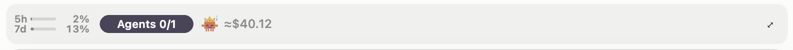
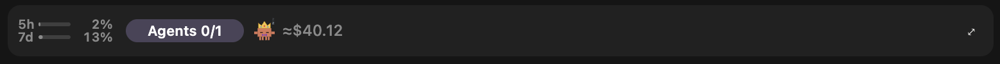
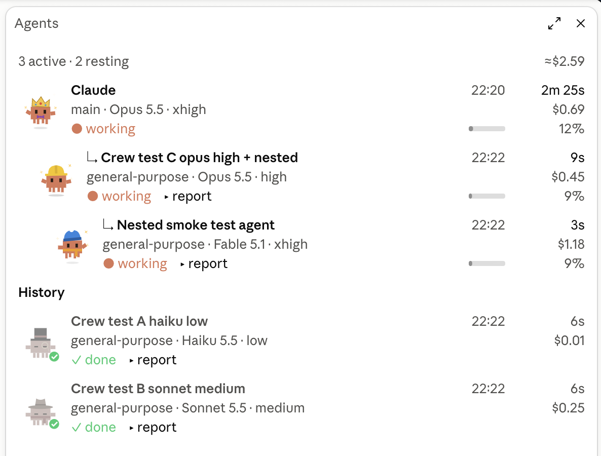

# agent-crew

A [Claude Code](https://claude.com/claude-code) mod that shows your agents and subagents live. Each one is a small pixel-art crab in an outfit of its own, and you also see what each one costs, how full its context is, and how much of your plan's usage limits you have left.

> Unofficial community project. Not affiliated with, endorsed or sponsored by Anthropic.

## Screenshots

<!-- Put the images in docs/screenshots/ under these names. A PNG at 2× (Retina) stays sharp. -->

**The band above the prompt**: usage limits, agents and session cost.

| Light | Dark |
|---|---|
|  |  |

**The detail pane**: the main agent, live subagents, and history.



**A report expanded** with `▸ report`.


**In a terminal.**


## What you get

**A one-line band above the prompt.** It is always visible and stays the height of a single line.

```
5h ▰▰▱▱▱  24%   ( Agents 2/3 )  👑 🎩 🧙  ≈$4.20          ⤢
7d ▰▱▱▱▱  12%
```

- **Usage limits**: your current session (5h) and weekly (7d) windows, as % used. The bar turns amber at 75% and red at 90%, and the tooltip gives the reset time. Every open session shows the latest reading from any of them.
- **The agents pill**: it fills as agents work. Next to it is one animated mascot per live agent: the main agent wears a crown, and each subagent gets a stable outfit (wizard, chef, viking, DJ…).
- **The session's total cost**, as `/cost` reports it.

**A detail pane.** Open it with `⤢` or `/crew`.

```
3 active · 2 resting                              ≈$47.60
Claude                              16:18          1h 12m
main · Opus 5.5 · high                             $45.91
● working                           ▰▰▱▱▱             26%
  ↳ Explore band layout             17:21          3m 05s
    Explore · Sonnet 5.5 · medium                   $0.42
    ● working  ▸ report             ▱▱▱▱▱              5%
History
UI/UX design for limit gauges       17:01          2m 33s
general-purpose · Opus 5.5 · high                   $1.18
✓ done  ▸ report
```

Each row shows the start time, the duration, the agent's own estimated cost, and a context gauge. `▸ report` expands the agent's task and its final answer. Finished agents move to a History section, and it comes back when you resume the session.

## Requirements

You need a Claude Code build that supports mods: plugins with a hooks module (`hooks/hooks.json` → `modules`). The mod draws on every surface:
- **Desktop app and IDE:** with graphics.
- **Terminal:** as text.

The usage-limit gauge needs a Claude subscription. Without one it simply doesn't show.

## Install

From a terminal Claude Code session:

```
/plugin install agent-crew --marketplace <github-user>/agent-crew
```

Or from your shell:

```bash
claude plugin marketplace add <github-user>/agent-crew
```

```bash
claude plugin install agent-crew@thomas-mods --scope user
```

Installed at the user scope, the mod loads in all your sessions, the desktop app's included. A session that was already open picks it up with `/reload-plugins`.

To update:

```bash
claude plugin update agent-crew@thomas-mods
```

## Your data stays on your machine

The mod sends nothing anywhere. To give you history across restarts and limits that stay current, it keeps the following in Claude Code's local plugin store (`~/.claude/plugins/store/`):

- **Per session:** each subagent's name, type, model, timings, token counts and estimated cost. It also keeps the first 1,500 characters of the task each subagent was given and the first 6,000 characters of its report.
- **Shared by your sessions:** the latest usage-limit reading.

When the store fills up, the oldest sessions' history is dropped first. Delete that file to erase it all.

## About the numbers

- **Session total:** this is Claude Code's own `/cost` figure.
- **Per-agent costs:** these are estimates made from Anthropic's public list prices, which are included in the code with the date they were read.
  - Cache writes are priced at the 5-minute rate.
  - Fast mode and US-only inference are not modelled.
  - An unknown model counts as $0 rather than a guess.
- **The main agent's cost:** the session total minus its subagents' estimates.
- **Usage limits:** these are the readings Claude Code receives with each API response. Usage made elsewhere, on claude.ai or another device, appears at the next reading, and the tooltip says when a reading is more than 5 minutes old.

## Contributing

Contributions are welcome. Bug fixes, new outfits, price updates and UI ideas all count, and pull requests are open to everyone.

**Small fixes:** open a pull request directly. Typos, a new price, a bug with an obvious fix all go this way.

**Bigger changes:** open an issue first, so we agree on the idea before you spend time on it. That covers a new feature or a layout change.

**Try your change in a real session:**

1. Fork and clone the repository.
2. Start Claude Code on your copy:

   ```bash
   claude --plugin-dir ./agent-crew
   ```

   The folder is watched, so each save reloads the mod. If you also installed it from the marketplace, disable that copy first:

   ```bash
   claude plugin disable agent-crew@thomas-mods
   ```

3. Change the code. It is all in `hooks/register.tsx`, and the state it keeps is described in `types/index.d.ts`.
4. Before opening the pull request, make sure both commands pass:

   ```bash
   claude plugin validate .
   ```

   ```bash
   claude plugin test .
   ```

**What makes a pull request quick to merge:**

- **One change per pull request**, with a [Conventional Commits](https://www.conventionalcommits.org) title such as `fix: …` or `feat: …`.
- **A test** in `hooks/register.test.ts` for any calculation or format you touch. The existing ones cover prices, formats, the limits gauge, history and the band layout.
- **A before/after screenshot** for any visual change. A light and a dark one is ideal.
- **A link to the source** for any price change: Anthropic's pricing page and the date you read it.

By contributing, you agree that your contribution is released under this project's [MIT License](LICENSE).

## Legal

- Released under the [MIT License](LICENSE).
- Unofficial and independent. This project is not affiliated with, endorsed by, or sponsored by Anthropic PBC.
- "Claude", "Claude Code" and Anthropic's names, logos and characters are trademarks of Anthropic PBC, mentioned here only to say what this mod works with. The pixel-art crabs are original drawings made for this project.
- Prices and model names are public information, may change, and are provided without warranty. Check your actual bill with Anthropic.
